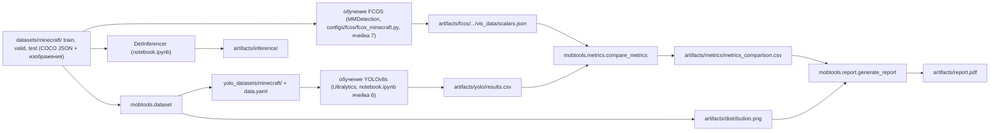

# minecraft_mob_detection: детекция мобов Minecraft (FCOS и YOLOv8s)

Учебный проект (в коде он назван coursework: `mobtools/__init__.py:1`, `mobtools/report.py:4`)
по детекции 17 классов мобов Minecraft на датасете в формате COCO. Собственный код проекта —
пакет `mobtools`: подготовка датасета для Ultralytics YOLO, сравнение итоговых метрик YOLOv8s и
FCOS и сборка PDF-отчёта. Остальное дерево (`tools/`, `demo/`, `configs/`) — вендорная копия
mmdetection (`THIRD_PARTY.md`). Для кого кроме автора и курса предназначен проект, в файлах не
сказано.

## Состояние

- Последний коммит ветки `dev`: `f5d087f`, 2026-08-08 (`scripts/check_before_push.py`).
  Последнее изменение `mobtools/` и `tests/`: `c9cb470`, `pyproject.toml`: `53a1bda`, оба 2026-08-06.
  `notebook.ipynb` и `configs/fcos/fcos_minecraft.py` не менялись с `0536db1`, 2026-03-11.
- Тесты есть: `tests/test_dataset.py` и `tests/test_metrics_and_report.py`, 18 тестовых функций
  (подсчёт по тексту файлов; локально не собирались — см. «Об этом документе»).
- CI есть: `.github/workflows/python-ci.yml` (ruff check, ruff format --check, pytest; только
  push и pull request в `dev`, строки 6-10). Прогон «Python CI» на `f5d087f` (push в `dev`,
  2026-08-07 по UTC) на GitHub завершился успешно, все шаги — Lint, Format check, Test
  (`gh run view`, проверено 2026-11-18).
- Ветка `origin/release` (на неё указывает `origin/HEAD`) содержит 15 коммитов от 2026-11-08,
  которых нет в `dev` (`recipe.ps1`, `tools/wiki.py`, `docs/install.md`, `docs/manual.md`,
  `uv.lock`, новые тесты). Этот документ описывает только `dev` на `f5d087f`.
- Явно не доделано: README описывает только «Фазу 1» (`README.md:25-56`); сравнение по FPS
  заявлено (`README.md:3`, `:12`), но кода замера нет; инференс на видео в ноутбуке есть
  (ячейки 8-9), но его результаты в `artifacts/videos/` игнорируются (`.gitignore:2`) и в git их
  нет; файла `requirements.txt` из `README.md:16` в репозитории нет.

## Структура

| Путь | Что это |
| --- | --- |
| `mobtools/dataset.py` | чтение COCO, график распределения классов, отрисовка рамок, COCO → YOLO, сборка `data.yaml` |
| `mobtools/metrics.py` | чтение последней эпохи из `results.csv` (Ultralytics) и JSON-лога (MMDetection), таблица сравнения |
| `mobtools/report.py` | PDF-отчёт на fpdf2 с кириллическим шрифтом из `ttf/` |
| `utils.py` | прослойка совместимости: реэкспорт имён `mobtools` для `notebook.ipynb` |
| `notebook.ipynb` | 11 ячеек: каталоги и импорт (1), YOLO-датасет (2), EDA (3-4), инференс FCOS через `DetInferencer` (5), обучение YOLOv8s (6) и FCOS (7), инференс YOLO на тесте и видео (8), FCOS на видео (9), `compare_metrics` (10), `generate_report` (11) |
| `configs/fcos/fcos_minecraft.py` | конфиг дообучения FCOS на 17 классах |
| `tests/` | pytest-тесты `mobtools` |
| `scripts/check_before_push.py` | локальный прогон команд из `.github/workflows`, установка pre-push хука |
| `artifacts/yolo/` | результаты обучения YOLOv8s: `args.yaml`, `results.csv`, графики; веса игнорируются (`.gitignore:1`) |
| `artifacts/fcos/20260311_015948/` | лог обучения FCOS и `vis_data/scalars.json` (JSON Lines) |
| `artifacts/metrics/metrics_comparison.csv` | таблица Model, mAP, mAP_50 |
| `artifacts/inference/` | предсказание FCOS на одном тестовом изображении (`preds/*.json`, `vis/*.jpg`) и `test_eda.jpg` |
| `artifacts/report.pdf`, `report.pdf` | два разных сгенерированных отчёта (2 и 6 страниц) |
| `ttf/` | шрифты DejaVu для PDF |
| `tools/`, `demo/`, `configs/` | вендорный mmdetection, Apache-2.0 (`THIRD_PARTY.md`) |

## Архитектура

Пакет `mobtools` не обучает модели. Он готовит вход для Ultralytics, читает то, что оставили
два тренера, и собирает отчёт. Обучение запускают ячейки 6 (`YOLO('yolov8s.pt').train(...)`) и 7
(`!python tools/train.py configs/fcos/fcos_minecraft.py --work-dir artifacts/fcos`) ноутбука.



Внешние зависимости: предобученные веса FCOS скачиваются по URL из
`configs/fcos/fcos_minecraft.py:77`, YOLO стартует с `yolov8s.pt` (`artifacts/yolo/args.yaml:3`).
Инференс в ноутбуке требует CUDA-устройство `cuda:0` (`notebook.ipynb`, ячейка 5). Обучение FCOS
шло на Windows, Python 3.10.0, PyTorch 2.0.0+cu118, одна GPU (заголовок
`artifacts/fcos/20260311_015948/20260311_015948.log:1-39`).

## Сборка и запуск

Требования: Python 3.10 (`README.md:26`, `pyproject.toml:8`, `python-ci.yml:19`). Версии
библиотек не закреплены: lock-файла нет, единственное ограничение — `mmcv>=2.0.0` (`README.md:51`).

Установка полного окружения по `README.md:32-52`:

```powershell
python -m venv .venv
.\.venv\Scripts\Activate.ps1
pip install torch torchvision torchaudio --index-url https://download.pytorch.org/whl/cu118
pip install -U openmim
mim install mmengine
mim install "mmcv>=2.0.0"
pip install mmdet ultralytics jupyterlab pycocotools opencv-python pandas matplotlib
```

В `README.md:42` URL индекса записан как Markdown-ссылка внутри блока кода; выше он дан без
скобок. В списке `README.md:52` нет `fpdf2`, без которого не импортируется `mobtools.report`,
а значит и `utils` (`mobtools/__init__.py:16`). CI ставит его отдельно (`python-ci.yml:25`).

Только для тестов и линта (`python-ci.yml:24-25`):

```sh
python -m pip install --upgrade pip
pip install ruff pytest pandas matplotlib opencv-python-headless pillow fpdf2 numpy
```

Данные: датасет кладётся в `datasets/minecraft/` (`README.md:56`), каталог игнорируется
(`.gitignore:3`). Код ожидает подкаталоги `train/`, `valid/`, `test/`, в каждом свой
`annotations.json` (`mobtools/dataset.py:48`, `:210`; `configs/fcos/fcos_minecraft.py:31`, `:46`).
`README.md:56` называет папку `val` и один `annotations.json` — это расходится с кодом.

Запуск: `notebook.ipynb` открывается в JupyterLab (ставится в `README.md:52`; команда запуска в
файлах не указана). Ячейки выполняются из корня репозитория: пути в них относительные.

## Конфигурация

Переменных окружения код не читает. Настройки — параметры функций и файлы:

| Что | Где | Значение / по умолчанию |
| --- | --- | --- |
| Список классов | `mobtools/dataset.py:27-45` | 17 имён по алфавиту, `bee` … `zombie` |
| Отбрасываемая категория | `mobtools/dataset.py:25` | `minecraft-mobs` |
| Сплиты | `mobtools/dataset.py:48` | `train`, `valid`, `test` |
| Расширения изображений | `mobtools/dataset.py:47` | `.jpg`, `.jpeg`, `.png` |
| Каталог шрифтов | `mobtools/report.py:15` | `ttf` относительно текущего каталога |
| Путь отчёта | `mobtools/report.py:117` | `artifacts/report.pdf` |
| FCOS: классы, вход, батч | `configs/fcos/fcos_minecraft.py:6`, `:16`, `:22` | 17 классов, 512×512 с сохранением пропорций, batch 2 |
| FCOS: обучение | `configs/fcos/fcos_minecraft.py:65-76` | 100 эпох, валидация каждую эпоху, SGD lr 0.00125, шаги LR на 70 и 90 эпохе |
| YOLO: параметры прогона | `artifacts/yolo/args.yaml:3-9` | `yolov8s.pt`, 12 эпох, batch 16, imgsz 512 (запись прогона, кодом не читается) |
| Линтер и pytest | `pyproject.toml` | ruff line-length 100, py310; `testpaths = ["tests"]`, `pythonpath = ["."]` |
| `scripts/check_before_push.py` | `:329-330` | `--install-hook` пишет `.git/hooks/pre-push`; `--quiet` укорачивает вывод |

## Использование

Вызовы из `notebook.ipynb` (ячейки 2-4, нумерация с 1; имя изображения сокращено):

```python
from utils import prepare_yolo_dataset
prepare_yolo_dataset('datasets/minecraft', 'yolo_datasets/minecraft')
counts = analyze_coco_distribution('datasets/minecraft/train/annotations.json', 'artifacts/distribution.png')
visualize_bboxes('datasets/minecraft/test/<имя>.jpg', 'datasets/minecraft/test/annotations.json', None, 'artifacts/inference/test_eda.jpg')
```

Ячейка 5 запускает `mmdet.apis.DetInferencer` с `configs/fcos/fcos_minecraft.py` и весами
`checkpoints/fcos_r50_caffe_fpn_gn-head_1x_coco-821213aa.pth` на `cuda:0` и пишет результат в
`artifacts/inference/`. Каталога `checkpoints/` в репозитории нет. Сохранённый вывод ячейки 5
сообщает `size mismatch for bbox_head.conv_cls.weight` (в чекпойнте 80 классов, в модели 17):
это COCO-веса, голова классификации из них не загружена, так что закоммиченное предсказание в
`artifacts/inference/` сделано не дообученной моделью.

`compare_metrics` и `generate_report` ноутбук импортирует из `utils` (ячейка 1) и вызывает в
ячейках 10 и 11 с теми же путями, что ниже (здесь — импорт из `mobtools`). Сохранённый вывод
ячейки 10 — `NameError: name 'compare_metrics' is not defined`, ячейки 11 — сообщение об успешной
генерации отчёта. В этой проверке код не запускался:

```python
from mobtools import compare_metrics, generate_report
compare_metrics('artifacts/yolo/results.csv',
                'artifacts/fcos/20260311_015948/vis_data/scalars.json',
                'artifacts/metrics/metrics_comparison.csv')
generate_report('artifacts/distribution.png', 'artifacts/metrics/metrics_comparison.csv')
```

Вторым аргументом `compare_metrics` нужен JSON Lines (`vis_data/scalars.json`). Текстовый
`.log` даст `ValueError`: строки с `coco/bbox_mAP` в нём не JSON и пропускаются
(`mobtools/metrics.py:39-47`; вывод по коду).

## Тестирование

`pytest` из корня (`python-ci.yml:34`; `pyproject.toml` задаёт `testpaths` и `pythonpath`).
Полный набор проверок CI локально: `python scripts/check_before_push.py`
(`scripts/check_before_push.py:15`).

Что покрыто: подсчёт и порядок классов, нормализация рамок COCO → YOLO на вычисленных вручную
значениях, отбрасывание `minecraft-mobs`, пустой файл меток для изображения без разметки, сборка
каталогов и `data.yaml`, пропуск отсутствующего сплита, отрисовка рамок и ошибка для неизвестного
изображения (`tests/test_dataset.py`); последняя эпоха YOLO, пропуск строк обучения и обрезанной
строки в логе FCOS, ошибки пустых входов, таблица сравнения, запись PDF с секцией метрик и без неё,
ошибка без графика (`tests/test_metrics_and_report.py`). Не покрыты: `KeyError` при переименованных
колонках (`metrics.py:26-28`), откат на Helvetica без шрифтов (`report.py:52-54`), `utils.py`,
ноутбук, конфиг FCOS, `scripts/check_before_push.py`.

## Известные ограничения и проблемы

- `.gitignore:3` (`datasets/`) игнорирует и `configs/_base_/datasets/`; файла
  `configs/_base_/datasets/coco_detection.py`, на который ссылается
  `configs/fcos/fcos_r50-caffe_fpn_gn-head_1x_coco.py:2`, в репозитории нет (проверено
  `git check-ignore -v`). Вывод: `fcos_minecraft.py` из свежего клона не загрузится.
- Строка FCOS в `artifacts/metrics/metrics_comparison.csv` (mAP 0.041, mAP_50 0.089) не
  выводится из закоммиченного лога: в `scalars.json` 100 записей валидации, минимальная mAP 0.162,
  последняя 0.297 / 0.476. `report.pdf` в корне показывает 0.297 / 0.476, `artifacts/report.pdf` —
  0.041 / 0.089. Откуда взялись 0.041 / 0.089, по файлам не установить.
- Обе закоммиченные PDF озаглавлены «Аналитический отчёт по дорожной обстановке» — заголовок
  старой версии кода (`git show 0536db1:utils.py`); текущий код пишет другой (`report.py:19`).
  Страницы 3-6 корневого `report.pdf` («Пример визуализации») не создаёт ни текущий код, ни код
  `0536db1`; сам файл добавлен отдельным коммитом `d0d787c` («Add files via upload»).
- `visualize_bboxes` ищет изображение подстрокой: `filename in image["file_name"]`
  (`mobtools/dataset.py:109`). `a.jpg` совпадёт с `ba.jpg`, если тот раньше в списке, и будут
  нарисованы чужие рамки.
- `data.yaml` всегда пишет 17 имён `MINECRAFT_CLASSES` (`dataset.py:196`, `:231-232`), а индексы
  классов в метках назначаются по возрастанию `category_id` (`dataset.py:156-160`). Что эти
  порядки совпадают в реальном экспорте, код не проверяет. Косвенный признак расхождения в
  сохранённых выводах ноутбука: в train у `wolf` 4 аннотации (ячейка 3), а валидация YOLO
  насчитывает под именем `wolf` 138 объектов на 85 из 422 изображений (ячейка 6). Это не
  доказательство.
- `analyze_coco_distribution` считает и категорию `minecraft-mobs` (`dataset.py:71`,
  `tests/test_dataset.py:56`).
- `data.yaml` содержит абсолютный путь (`dataset.py:226`).
- Шрифты ищутся в `ttf/` относительно текущего каталога (`report.py:15`); отчёт из другого
  каталога пойдёт на Helvetica без кириллицы.
- Бюджеты обучения разные: YOLOv8s 12 эпох (`args.yaml:5`), FCOS 100 эпох
  (`fcos_minecraft.py:65`).
- `yolo_datasets/` и `checkpoints/`, которые использует ноутбук, не внесены в `.gitignore`.
- В `README.md:8` сказано, что в `configs/` есть конфигурация Ultralytics; там только конфиги
  mmdetection (`configs/yolo/` — YOLOv3 из mmdetection). В `README.md:10` упомянуты веса — в git
  их нет.

## Связанные документы

- [Спецификация требований](../SPEC.md)
- [README проекта](../README.md)
- [Что чьё в дереве и под какой лицензией](../THIRD_PARTY.md)
- [Лицензия MIT](../LICENSE), [Apache-2.0 для кода OpenMMLab](../LICENSES/Apache-2.0-OpenMMLab.txt)
- [Конфиг FCOS](../configs/fcos/fcos_minecraft.py), [CI](../.github/workflows/python-ci.yml)
- [Итоговый отчёт](../report.pdf), [отчёт из artifacts](../artifacts/report.pdf)

## Об этом документе

Написан 2026-11-18 по коммиту `f5d087f` (ветка `dev`). Для проверки выполнены: `git ls-files`,
`git log`, `git show 0536db1:utils.py`, `git diff --stat origin/dev origin/release`,
`git check-ignore -v`, чтение исходного кода ячеек `notebook.ipynb` (без выводов), извлечение
текста обеих PDF через pypdf, `python scripts/check_before_push.py --help`,
`python -m pytest --collect-only -q -p no:cacheprovider` — сбор упал с `ModuleNotFoundError`
(pandas, cv2 в этом окружении не установлены), так что тесты не собирались и не запускались.
Не запускались: pytest, ruff, ноутбук, обучение, инференс, `compare_metrics`, `generate_report`.

При независимой проверке 2026-11-18 дополнительно прочитаны сохранённые выводы ячеек
`notebook.ipynb`, сверён `scripts/check_before_push.py` с repo-quality-template и запрошен
статус CI через `gh run list` / `gh run view`.
